# HFT LOB SDK

> [!WARNING]
> **Status:** The signal research and paper diagnostics are a research prototype. The `hft_feed` runtime and live adapters are production-oriented infrastructure for integration and evaluation, but they are not a live trading system or investment advice. Validate on your data and hardware, complete security/compliance review, and add your own risk and execution stack before deploying capital.

A C++20 low-latency limit-order-book signal engine, benchmark suite, and Python research toolkit.

The project ingests market-data events, maintains rolling order-book imbalance signals, evaluates them against forward returns, exports regime tuples for Python-side Hawkes analysis, and runs a deterministic execution-cost backtest. It is engineering and research infrastructure, not a live trading system or investment advice.

## Highlights

- Cache-line-aligned lock-free ring buffers and an SPSC queue.
- Count-based and volume-weighted order-book imbalance (`OBI`, `OBI(V)`).
- Structural filters: lifetime, modification count, and modification time.
- Both a causal streaming mode and a paper-faithful ex-post order-filter mode.
- 1s / 10s / 30s / 50s rolling horizons, plus the paper's 1/10/20/30/50/80/100 s diagnostics.
- SIMD Welford statistics with ARMA/AR(1) residualized regime correlations.
- 9x3 regime scores, a 12x12 continuous-time sum-of-exponentials Hawkes MLE, and aligned-pair cross-excitation norms.
- Deterministic PnL with configurable maker/taker fees, execution latency, and trade-level charts.
- C++ shared library with `find_package(HftSdk)` support.
- pybind11 bindings for NumPy/Pandas workflows.
- `pip install .` plus `hft-sdk` CLI, with public-data download and caching.
- Stress/edge-case harness with peak-RSS and wall-time measurements.
- Multi-consumer Disruptor fan-out, a staged-consumer dependency barrier, and cross-thread benchmarks.
- Paper-2 microbenchmark suite and a cointegration pairs-trading backtest.
- LaTeX equations for every layer (see [Mathematical specification](#mathematical-specification)).
- Reproducible Google Benchmark suite, dark-mode charts, and generated reports (see [Benchmarks](#benchmarks)).

## Architecture

```text
market data
    |
    v
ingest adapters (file replay + Binance/Bybit live)
    |
    v
hft_feed runtime (config, structured logs, Prometheus, health)
    |
    v
SPSC queue / ring buffer
    |
    v
order tracker -> filter masks -> rolling count & volume windows
    |
    v
signal snapshots -> metrics / regime tuples
    |
    +--> C++ PnL backtest
    |
    +--> paper-faithful filters + regime/Hawkes diagnostics
    |
    +--> Python Layer 3: Hawkes kernel + report
```

The equations implemented by each layer are specified in
[Mathematical specification](#mathematical-specification).

## Mathematical specification

This section states the equations implemented by the SDK. The **streaming**
mode and the **paper-faithful** mode differ where noted.

### Notation

Let the event stream be

$$
\{e_i=(t_i,\tau_i,s_i,q_i,o_i)\}_{i=1}^{N},
$$

where $t_i$ is the timestamp, $\tau_i$ the event type (new, modify, cancel,
trade), $s_i$ the side, $q_i$ the quantity, and $o_i$ the order identifier.
Events are processed in non-decreasing timestamp order.

For a window $W=(t-h,t]$, define the indicator
$\mathbf{1}[P]=1$ when predicate $P$ is true and $0$ otherwise.

### 1. Directional counts and OBI

For non-trade LOB events, the count-based directional counts are

$$
N_b(W)=\sum_{t_i\in W}\mathbf{1}[\tau_i\neq T]\,\mathbf{1}[s_i=\text{bid}],
\qquad
N_a(W)=\sum_{t_i\in W}\mathbf{1}[\tau_i\neq T]\,\mathbf{1}[s_i=\text{ask}].
$$

For trade events,

$$
N_{\text{buy}}(W)=\sum_{t_i\in W}\mathbf{1}[\tau_i=T]\,\mathbf{1}[s_i=\text{buy}],
\qquad
N_{\text{sell}}(W)=\sum_{t_i\in W}\mathbf{1}[\tau_i=T]\,\mathbf{1}[s_i=\text{sell}].
$$

The LOB imbalance and the trade-based imbalance are

$$
\mathrm{OBI}(W)=\frac{N_a(W)-N_b(W)}{N_a(W)+N_b(W)},
\qquad
\mathrm{OBI}^{(T)}(W)=\frac{N_{\text{buy}}(W)-N_{\text{sell}}(W)}
{N_{\text{buy}}(W)+N_{\text{sell}}(W)}.
$$

A value is reported as invalid when the denominator is zero. Replacing
$N_\bullet$ by quantity sums $V_\bullet(W)=\sum q_i$ gives the volume-weighted
variants $\mathrm{OBI}^{(V)}$ and $\mathrm{OBI}^{(T,V)}$.

Implemented in `include/hft/OBIFilter.hpp`.

### 2. Structural filters

For order $j$, let

- $t_j^{(in)}$ be the first arrival,
- $t_j^{(out)}$ the final exit (cancel or full fill),
- $L_j=t_j^{(out)}-t_j^{(in)}$ the lifetime,
- $M_j$ the number of modification events,
- $\Delta_j=t_j^{(m_{\text{last}})}-t_j^{(m_{\text{prev}})}$ the final
  last-two-modification interval, with $\Delta_j=\infty$ when $M_j<2$.

The three masks are

$$
\mathbf{1}_{LF}=\mathbf{1}[L_j\ge \bar L],
\qquad
\mathbf{1}_{MF}=\mathbf{1}[M_j\le \bar M],
\qquad
\mathbf{1}_{MTF}=\mathbf{1}[\Delta_j\ge \bar\Delta].
$$

The paper-faithful path uses these **final** values for the whole order
lifecycle. The streaming path evaluates running values at each event:

$$
L_j(t)=t-t_j^{(in)},
\qquad
M_j(t)=\#\{\text{modifications up to }t\},
\qquad
\Delta_j(t)=t^{(m_{\text{last}})}-t^{(m_{\text{prev}})}.
$$

Full-fill tracking uses the remaining quantity

$$
R_j(t)=q_j^{(new)}-\sum_{\text{parent}=j,\;t_k\le t}q_k,
$$

and treats the order as exited when $R_j(t)\le 0$.

Implemented in `include/hft/OBIFilter.hpp` and `include/hft/Paper.hpp`.

### 3. Rolling windows and snapshots

The streaming OBI horizons are

$$
h\in\{1,10,30,50\}\ \text{seconds}.
$$

Snapshots are taken every $\Delta_s=250$ ms by default. For a bucket size
$\delta=1$ ms, the rolling aggregate at time $t$ contains events with

$$
t-h < t_i \le t.
$$

The paper-faithful mode uses a 10 s OBI window and anchors every 15 s.

### 4. Forward returns

The streaming engine uses log mid-price returns. For bid and ask ticks
$p^{bid}(t),p^{ask}(t)$ and mid

$$
m(t)=\frac{p^{bid}(t)+p^{ask}(t)}{2},
$$

the forward return is

$$
r_i(h)=\log\frac{m(t_i+h)}{m(t_i)}.
$$

The paper-faithful mode uses the realized traded return over
$(t,t+\xi]$:

$$
\tilde r_{(t,t+\xi]}=
\frac{p^{T}_{t^{last}}-p^{T}_{t^{first}}}{p^{T}_{t^{first}}},
$$

where $t^{first}$ and $t^{last}$ are the first and last trade timestamps in
the forecast window. Paper horizons are
$\xi\in\{1,10,20,30,50,80,100\}$ seconds.

### 5. Pearson correlation and SIMD Welford

For paired samples $(x_i,y_i)$,

$$
\rho(X,Y)=
\frac{\sum_{i=1}^{n}(x_i-\bar x)(y_i-\bar y)}
{\sqrt{\sum_{i=1}^{n}(x_i-\bar x)^2}\,
 \sqrt{\sum_{i=1}^{n}(y_i-\bar y)^2}},
\qquad R^2=\rho^2.
$$

The online update for the means, second moments, and covariance is

$$
n\leftarrow n+1,\qquad
\delta_x=x-\bar x,\qquad
\bar x\leftarrow\bar x+\frac{\delta_x}{n},
$$

$$
M_{2x}\leftarrow M_{2x}+\delta_x(x-\bar x),
\qquad
M_{2y}\leftarrow M_{2y}+\delta_y(y-\bar y),
\qquad
C\leftarrow C+\delta_x(y-\bar y).
$$

Merging two accumulators $a,b$ uses

$$
\bar x=\bar x_a+\frac{n_b}{n_a+n_b}(\bar x_b-\bar x_a),
\qquad
M_{2x}=M_{2x,a}+M_{2x,b}+
\frac{n_a n_b}{n_a+n_b}(\bar x_b-\bar x_a)^2,
$$

$$
C=C_a+C_b+
\frac{n_a n_b}{n_a+n_b}(\bar x_b-\bar x_a)(\bar y_b-\bar y_a).
$$

`SimdWelford` applies these updates per SIMD lane and merges the lanes in
`finalize()`.

For significance, the implementation reports the two-sided Pearson $t$-test

$$
t=r\sqrt{\frac{n-2}{1-r^2}},
\qquad
p=2\left(1-F_{t,n-2}(|t|)\right),
$$

and the Fisher $z$ interval

$$
\tanh\!\left(\operatorname{artanh}(r)\pm
\frac{1.96}{\sqrt{n-3}}\right).
$$

Regime-score confidence intervals use a window bootstrap: resample windows
with replacement, recompute the score, and report the 2.5% and 97.5%
percentiles. The paper uses overlapping windows, so these intervals are
descriptive rather than a formal multiple-testing correction.

### 6. Regime discretization

OBI is mapped to nine regimes:

$$
b_{\mathrm{OBI}}(x)=
\operatorname{clamp}\!\left(
\left\lfloor (\operatorname{clamp}(x,-1,1)+1)\cdot 4.5\right\rfloor,
0,8\right).
$$

The streaming engine uses four return regimes:

$$
b_{\mathrm{ret}}(x)=
\operatorname{clamp}\!\left(
\left\lfloor (\operatorname{clamp}(x,-1,1)+1)\cdot 2\right\rfloor,
0,3\right).
$$

The paper-faithful mode uses three regimes:

$$
b_{\mathrm{ret}}(x)=
\begin{cases}
0, & x<-\nu,\\
1, & |x|\le \nu,\\
2, & x>\nu,
\end{cases}
\qquad \nu=\tfrac12\operatorname{std}(r).
$$

The regime centers used by the streaming score are

$$
c_{\mathrm{OBI}}(b)=-1+\left(b+\tfrac12\right)\frac{2}{9},
\qquad
c_{\mathrm{ret}}(b)=-1+\left(b+\tfrac12\right)\frac{2}{4}.
$$

The paper's text says three return regimes while referring to a $13\times13$
kernel; the paper-faithful implementation uses $9+3=12$ states and documents
the inconsistency.

### 7. Directional regime score

For paper return regimes ordered from negative to positive, define

$$
a_j=j-\frac{9-1}{2}=j-4,
\qquad
b_i\in\{-\gamma,0,\gamma\},
\qquad
W_{ij}=1+b_i a_j,
\qquad \gamma=0.2.
$$

Let $Q_\tau\in\mathbb{R}^{9}$ be the OBI-regime count vector in window $\tau$
and $R_\tau\in\mathbb{R}^{3}$ the return-regime count vector. The implemented
directional correlation matrix is formed **across windows**:

$$
\bar\rho_{ij}=
\operatorname{corr}\!\left(
\{Q_{\tau,j}\}_{\tau=1}^{B},
\{R_{\tau,i}\}_{\tau=1}^{B}
\right),
\qquad
S^\rho=\sum_{i=0}^{2}\sum_{j=0}^{8}W_{ij}\,\bar\rho_{ij}.
$$

The regression score fits

$$
R=Q\beta+\varepsilon
$$

across the $B$ windows and averages the per-return-regime coefficient of
determination:

$$
S^R=\frac{1}{3}\sum_{i=0}^{2}R_i^2.
$$

The residualized variants fit a univariate ARMA(1,1) to each component of
$Q$ and $R$ before recomputing the scores. The lag-$\ell$ variant pairs
$Q_\tau$ with $R_{\tau+\ell}$.

The paper describes per-window correlation matrices and a sum of per-window
$R^2$ values. The implementation uses the cross-window form above and
documents this ambiguity in the generated report.

### 8. Hawkes excitation

The paper's multivariate Hawkes intensity is

$$
\lambda_i(t)=\mu_i+\sum_{j=1}^{d}\int_0^t\phi_{ij}(t-s)\,dN_j(s),
$$

with sum-of-exponentials kernels

$$
\phi_{ij}(u)=\sum_{m=1}^{M}\alpha_{ij}^{(m)}\beta_m e^{-\beta_m u}
\mathbf{1}_{u>0}.
$$

The integrated kernel and spectral radius are

$$
\Phi_{ij}=\int_0^\infty\phi_{ij}(u)\,du=\sum_{m=1}^{M}\alpha_{ij}^{(m)},
\qquad
\rho(\Phi)=\max_k|\lambda_k(\Phi)|.
$$

For the paper-faithful continuous-time fit, let $t_k$ be event times and
$j(k)$ the source state of event $k$. With a fixed decay grid
$\{\beta_m\}_{m=1}^{M}$,

$$
R_{jm}(t)=\sum_{t_j^k<t}e^{-\beta_m(t-t_j^k)},
\qquad
\lambda_i(t)=\mu_i+\sum_{j,m}\alpha_{ijm}\beta_m R_{jm}(t).
$$

The log-likelihood is

$$
\ell=
\sum_{k=1}^{N}\log\lambda_{i_k}(t_k)
-\sum_{i=1}^{d}\mu_i T
-\sum_{i,j,m}\alpha_{ijm}A_{jm},
$$

$$
A_{jm}=\sum_{t_j^k}\left(1-e^{-\beta_m(T-t_j^k)}\right).
$$

The implementation maximizes this with nonnegative multiplicative
(Poisson/EM) updates,

$$
\alpha_{ijm}\leftarrow
\alpha_{ijm}\,
\frac{\sum_{k:i_k=i}X_{k,j,m}/\lambda_i(t_k)}{A_{jm}},
\qquad
\mu_i\leftarrow
\mu_i\,
\frac{\sum_{k:i_k=i}1/\lambda_i(t_k)}{T},
$$

where $X_{k,j,m}=\beta_m R_{jm}(t_k)$.

The aligned-pair cross-excitation norm is

$$
\mathcal A=\{(0,0),\dots,(0,3),(1,4),(2,5),\dots,(2,8)\},
\qquad
S^\phi=\left(\sum_{(i,j)\in\mathcal A}\Phi_{ij}^2\right)^{1/2}.
$$

An optional stability step rescales $\Phi$ to spectral radius $0.99$.

### 9. Backtest and PnL

For trade $k$ with side $s_k\in\{-1,+1\}$, entry mid $m^{in}_k$, exit mid
$m^{out}_k$, and fee rate $f$ per side,

$$
g_k=s_k\left(\frac{m^{out}_k}{m^{in}_k}-1\right),
\qquad
\text{fee}_k=2f,
\qquad
n_k=g_k-\text{fee}_k.
$$

Equity and total return are

$$
E_k=\prod_{j=1}^{k}(1+n_j),
\qquad
R_{\text{total}}=E_N-1.
$$

The drawdown path is

$$
D_k=1-\frac{E_k}{\max_{j\le k}E_j},
\qquad
D_{\max}=\max_k D_k.
$$

Other reported statistics include

$$
\text{Sharpe}_{\text{trade}}=\frac{\bar n}{\sigma_n},
\qquad
\text{Sharpe}_{\text{daily}}=\sqrt{365}\,\frac{\bar n_d}{\sigma_{n_d}},
$$

$$
\text{win rate}=\frac1N\sum_{k=1}^{N}\mathbf{1}[n_k>0],
\qquad
\text{profit factor}=
\frac{\sum_{k:n_k>0}n_k}{\left|\sum_{k:n_k<0}n_k\right|}.
$$

Trades are non-overlapping and fill at the first snapshot on or after the
signal time plus the configured latency.

### 10. Pairs trading (paper 2)

The hedge ratio is estimated by ordinary least squares:

$$
(\hat\alpha,\hat\beta)=
\arg\min_{\alpha,\beta}\sum_{t=1}^{N}(y_t-\alpha-\beta x_t)^2.
$$

The spread and rolling z-score are

$$
S_t=y_t-\hat\alpha-\hat\beta x_t,
\qquad
z_t=\frac{S_t-\mu_t}{\sigma_t},
$$

where $\mu_t$ and $\sigma_t$ are the rolling mean and standard deviation over
the configured window.

The position rule is

$$
p_t=
\begin{cases}
+1, & z_{t-1}\le -z_{\text{in}},\\
-1, & z_{t-1}\ge z_{\text{in}},\\
0, & |z_{t-1}|\le z_{\text{out}},\\
p_{t-1}, & \text{otherwise}.
\end{cases}
$$

The backtest PnL increment is

$$
\Delta E_t=
p_t(S_t-S_{t-1})
-\text{fee}\cdot|p_t-p_{t-1}|
\left(|y_t|+|\hat\beta x_t|\right).
$$

The report also includes the augmented Dickey-Fuller p-value of the spread.

### 11. Transport metrics

For $N$ events processed in total time $T$,

$$
L=\frac{T}{N},
\qquad
X=\frac{N}{T}=\frac1L,
\qquad
\text{speedup}=\frac{L_{\text{queue}}}{L_{\text{ring}}}.
$$

The ring buffer maps sequence $s$ to slot $s\bmod C$ and publishes a slot by
storing the sequence number itself, which avoids ABA ambiguity.

## Requirements

- CMake 3.24+
- C++20 compiler (Clang or GCC)
- Python 3.9+ for plotting and bindings
- `numpy`, `pandas`, `matplotlib`, `seaborn`, `scipy`, `statsmodels`, `psutil` (see `benchmarks/requirements.txt`)
- `pyarrow` for Parquet data (installed automatically by `pip install .`)

`xsimd`, Google Benchmark, and pybind11 are fetched automatically when not installed.

## Install as a Python package

The fastest path if you only want to use the engine:

```bash
python3 -m pip install .
hft-sdk data/sample_ticks.csv --scheme MTF --horizon 10 --signal volume
```

Or from Python:

```python
import hft_sdk

result = hft_sdk.run_csv("data/sample_ticks.csv", scheme="MTF", horizon=10)
print(result.metrics_dataframe())      # requires pandas
print(result.backtest().total_return)

# Explicit engine control:
engine = hft_sdk.OBIFilterEngine()
engine.process_arrays(**hft_sdk.load_csv("data/sample_ticks.csv"))
```

`pip install ".[pandas]"` adds pandas; `pip install ".[live]"` adds the
websocket adapters. pyarrow is included by default for Parquet data. Wheels
are built portable by default; pass
`--config-settings=cmake.define.HFT_ARCH_NATIVE=ON` to target the local CPU.

## Fetch public data

The package downloads public datasets directly, so you do not need to manage
CSV or Parquet files by hand. Files are cached under `~/.cache/hft-sdk`
(override with `HFT_SDK_DATA_DIR`).

```python
import hft_sdk

# Download one crypto-lob-stream shard and run it.
path = hft_sdk.fetch_crypto_lob("BTCUSDT", "2026-08", table="depth")
result = hft_sdk.run_source(path, scheme="MTF", horizon=10)

# Or fetch + run in one call.
result = hft_sdk.run_crypto_lob("BTCUSDT", "2026-08", table="depth")

# Binance public archives, checksum-verified.
paths = hft_sdk.fetch_binance("BTCUSDT", "2024-01", "2024-03",
                              market="spot", kind="aggTrades", monthly=True)
result = hft_sdk.run_sources(paths)
```

From the shell:

```bash
hft-sdk fetch --crypto-lob BTCUSDT --period 2026-08 --table depth
hft-sdk fetch --binance BTCUSDT --start 2024-01 --end 2024-03 \
  --market spot --kind aggTrades --monthly
hft-sdk https://example.com/data.parquet
hft-sdk ~/.cache/hft-sdk/crypto-lob/depth/binance/BTCUSDT/2026-08.parquet
```

Downloads cover Binance `trades`/`aggTrades`/`bookDepth` archives and
crypto-lob-stream `depth`/`trades`/`snapshots`, plus generic HTTP(S) or
`hf://` URLs. The engine normalizes tick CSVs, Binance trade/bookDepth
archives, and crypto-lob depth/trades. Use `hft_sdk.iter_tick_arrays()` to
stream normalized NumPy arrays, or `hft_sdk.to_tick_csv()` to convert a
download into the SDK's tick CSV format.

## Production infrastructure

`hft_feed` is the long-running runtime for normalized market events:

```bash
hft_feed --config config/hft_feed.conf --replay data/sample_ticks.csv
curl -s http://127.0.0.1:9100/health
curl -s http://127.0.0.1:9100/metrics
```

It supports:

- file replay
- newline-delimited normalized CSV on stdin
- config files plus `HFT_*` environment overrides
- structured JSON logs
- Prometheus `/metrics`
- `/health` with state, counters, gaps, and last-event age
- graceful SIGINT/SIGTERM shutdown
- optional parent-order and sequence fields for gap detection

Live crypto perpetuals:

```bash
python3 -m pip install ".[live]"
python3 -m hft_sdk live --venue binance --symbol BTCUSDT --scheme MTF
python3 -m hft_sdk live --venue bybit --symbol BTCUSDT
```

The adapters reconnect with backoff, synchronize Binance depth snapshots with
the websocket stream, and track sequence gaps. Deployment and adapter guides:

- [`docs/QUICKSTART.md`](docs/QUICKSTART.md)
- [`docs/DEPLOYMENT.md`](docs/DEPLOYMENT.md)
- [`docs/ADAPTERS.md`](docs/ADAPTERS.md)
- [`docs/API_STABILITY.md`](docs/API_STABILITY.md)
- [`docs/BENCHMARKS.md`](docs/BENCHMARKS.md)

Container:

```bash
docker build -t hft-sdk:1.0.0 .
docker run --rm -p 9100:9100 hft-sdk:1.0.0 --config /etc/hft/hft_feed.conf --stdin
```

Commercial and operational documents:

- [`SECURITY.md`](SECURITY.md)
- [`SUPPORT.md`](SUPPORT.md)
- [`COMMERCIAL_TERMS.md`](COMMERCIAL_TERMS.md)
- [`CHANGELOG.md`](CHANGELOG.md)

## Quick Start

```bash
python3 -m pip install -r benchmarks/requirements.txt

cmake -S . -B build -DCMAKE_BUILD_TYPE=Release
cmake --build build -j
ctest --test-dir build --output-on-failure

./tools/run_pipeline.sh
```

The pipeline builds, runs tests, generates synthetic data, evaluates signals and PnL, runs the benchmark suite, and regenerates charts and `BENCHMARK_REPORT.md`.

## Outputs

```text
BENCHMARK_REPORT.md
benchmarks/results/
  latest_bench.json          Google Benchmark JSON
  signal_scores.csv          count + volume OBI metrics
  layer3_regimes.csv         time-synchronized regime tuples
  pnl_summary.json           return, Sharpe, drawdown, fees
  pnl_trades.csv             trade-level PnL
  hawkes_kernel.csv          13x13 integrated kernel (legacy)
  hawkes_cross_excitation.csv
  hawkes_summary.json
  paper/PAPER_REPORT.md      paper-faithful diagnostics
  paper/pearson_scores.csv
  paper/regime_scores.csv
  paper/hawkes_*.csv
  stress/STRESS_REPORT.md    stress/edge-case results
  soak/SOAK_REPORT.txt       long-run replay/soak results
  lowlatency/LOW_LATENCY_REPORT.md
  cache_counters.txt         Linux perf counters (or skip note)
  pairs/PAIRS_REPORT.md
  pairs/pairs_summary.json   ADF, hedge ratio, PnL, Sharpe
benchmarks/plots/
  queue_vs_ringbuffer.png
  latency_distribution.png
  signal_quality_heatmap.png
  pnl_trades.png             equity, per-trade return, drawdown
  hawkes_kernel.png
  hawkes_cross_excitation.png
  paper/*.png                paper-faithful charts
  lowlatency/*.png           threaded + microbenchmark charts
  pairs/pairs_equity.png     pairs-trading equity and z-score
```

## Real Data (C++ streaming path)

The Python `hft-sdk` commands above download and normalize data automatically.
For large files the C++ replay tools use a separate streaming path:

```bash
python3 tools/parquet_to_csv.py --table depth \
  --input ~/.cache/hft-sdk/crypto-lob/depth/binance/BTCUSDT/2026-08.parquet \
  --out data/btc_depth.csv \
  --asset BTCUSDT --exchange binance \
  --limit 5000000

./tools/run_real_data.sh data/btc_depth.csv BTCUSDT binance 1000 3000000
```

Real-data charts and report:

```text
benchmarks/plots/real/
benchmarks/results/REAL_DATA_REPORT.md
```

The AHR999 dataset (`kshift/ahr999-dataset`) is a daily valuation series, not order-book data, so it is not suitable for the OBI pipeline.

## C++ SDK

Build and install:

```bash
cmake -S . -B build -DCMAKE_BUILD_TYPE=Release \
  -DHFT_BUILD_SHARED_SDK=ON \
  -DHFT_BUILD_PYTHON=ON
cmake --build build -j
cmake --install build --prefix /opt/hft
```

Consume from another CMake project:

```cmake
find_package(HftSdk REQUIRED)
target_link_libraries(your_target PRIVATE HftSdk::sdk)
```

Header-only usage:

```cmake
find_package(HftSdk REQUIRED)
target_link_libraries(your_target PRIVATE HftSdk::core)
```

Example:

```cpp
#include <hft/HftSdk.hpp>

hft::sdk::OBIFilterEngine engine;
engine.process(events);

auto snapshots = engine.snapshots();
auto metrics = engine.metrics();
auto regimes = engine.regimes(hft::obi::FilterScheme::Lifetime, 2, true);

hft::backtest::Config config;
config.weight = hft::backtest::SignalWeight::Volume;
config.taker_fee_bps = 2.0;
config.latency_ns = 100'000;
auto pnl = engine.backtest(config);
```

Standalone SPSC queue:

```cpp
#include <hft/SPSCQueue.hpp>

hft::SPSCQueue<hft::MarketDataMessage, 65536> queue;
hft::MarketDataMessage message{};
queue.push(message);

hft::MarketDataMessage received{};
queue.pop(received);

// Or the SDK-provided global instance:
hft::g_market_data_queue.push(message);
```

## Python Bindings

The module is built for the Python interpreter selected by CMake:

```bash
PYTHONPATH=build python3 - <<'PY'
import hft_sdk

engine = hft_sdk.OBIFilterEngine()
engine.process_arrays(order_id, timestamp_ns, price_ticks, quantity,
                      bid_price_ticks, ask_price_ticks, type_codes, side_codes)

print(engine.metrics())
print(engine.backtest(hft_sdk.BacktestConfig()))
PY
```

For pandas:

```python
import hft_sdk
import pandas as pd

frame = pd.read_csv("data/sample_ticks.csv")
engine = hft_sdk.OBIFilterEngine()
engine.process_frame(frame)
print(pd.DataFrame(engine.metrics_table()).head())
```

## Benchmarks

Every number and chart in this section is generated by `./tools/run_pipeline.sh`
and checked in under [`benchmarks/`](benchmarks). This section reports the
original **streaming** pipeline; the **paper-faithful ex-post** diagnostics are
reported separately in [Paper-faithful diagnostics](#paper-faithful-diagnostics).
The full write-ups are [`BENCHMARK_REPORT.md`](BENCHMARK_REPORT.md) and
[`benchmarks/results/REAL_DATA_REPORT.md`](benchmarks/results/REAL_DATA_REPORT.md).

| Highlight | Result |
| --- | --- |
| RingBuffer vs mutex queue at 1M events | **2.71x** lower per-event latency |
| Cache-warm RingBuffer p50 / p99 | **2.0 ns / 3.2 ns** |
| SIMD Welford vs scalar | **2.01x** |
| Best synthetic count OBI | **LF, 30s**: Pearson 0.52081, R2 0.27124 |
| Best synthetic volume OBI | **LF, 30s**: Pearson 0.54889, R2 0.30128 |
| Synthetic backtest (2 bps/side) | 119 trades, **-4.3535%** total return |
| Hawkes branching ratio | **0.9900** |
| Real BTCUSDT volume OBI | R2 ~0.003 (not yet alpha) |

### Lock-free transport vs mutex queue

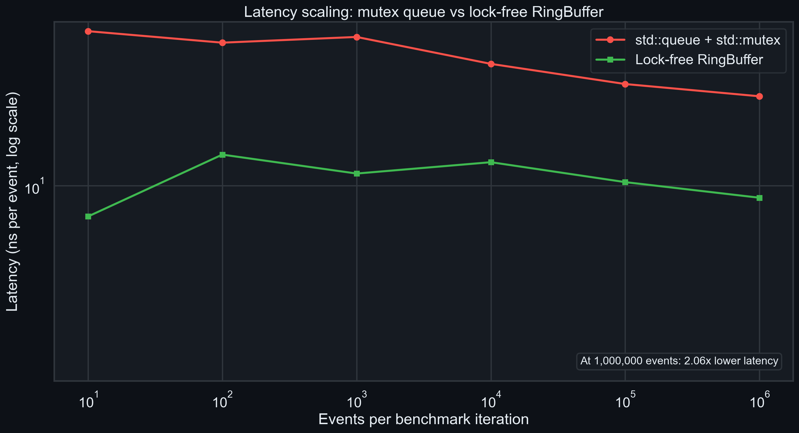

| Events | `std::queue` + mutex (ns/event) | RingBuffer (ns/event) | Speedup |
| --- | --- | --- | --- |
| 10 | 14.48 | 3.64 | 3.97x |
| 100 | 10.50 | 3.50 | 3.00x |
| 1,000 | 9.62 | 3.97 | 2.43x |
| 10,000 | 10.45 | 3.48 | 3.00x |
| 100,000 | 9.41 | 3.47 | 2.71x |
| 1,000,000 | 9.42 | 3.47 | **2.71x** |

The RingBuffer is preallocated and reuses a fixed-capacity ring; the queue
baseline performs a locked push and pop per event. Both run on one thread, so
this isolates synchronization/allocation cost rather than multi-core contention.

### Cache-cold vs cache-warm hand-off

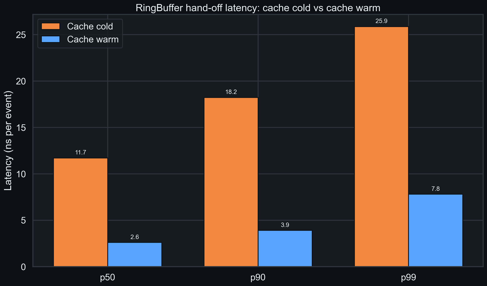

| Path | p50 (ns) | p90 (ns) | p99 (ns) | Samples |
| --- | --- | --- | --- | --- |
| Cache cold | 6.5 | 8.5 | 10.4 | 313 |
| Cache warm | 2.0 | 2.0 | 3.2 | 313 |

Cache-warm measurements run an explicit warm-up pass and prefetch the ring
before sampling. Latency is amortised over batches of 64 hand-offs.

### Signal quality (synthetic LOB stream)

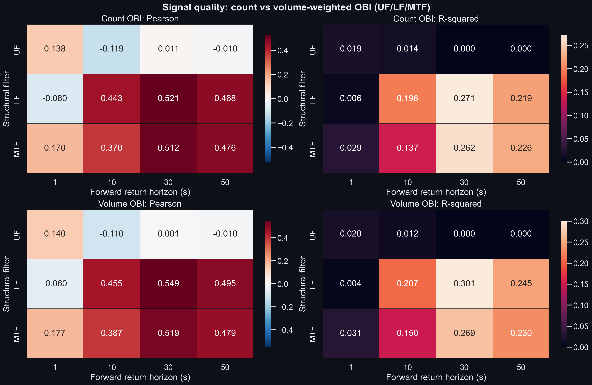

| Filter | Count mean abs Pearson | Count mean R2 | Volume mean abs Pearson | Volume mean R2 | Trade count ρ | Trade volume ρ |
| --- | --- | --- | --- | --- | --- | --- |
| UF | 0.06939 | 0.00834 | 0.06553 | 0.00798 | 0.46794 | 0.47493 |
| LF | **0.37798** | **0.17317** | **0.38970** | **0.18926** | 0.46491 | 0.46040 |
| MF | 0.37065 | 0.15265 | 0.38425 | 0.16359 | **0.48933** | **0.49861** |
| MTF | 0.38175 | 0.16346 | 0.39070 | 0.17009 | 0.48891 | 0.49799 |

Mean absolute Pearson is used for ranking so the OBI sign convention does not
hide magnitude. R2 is the square of the contemporaneous Pearson correlation.
Trade-count/trade-volume columns are mean absolute Pearson for the
trade-event-only signal. Regime cross-correlations are computed on AR(1)
residuals.

### Layer-3 Hawkes excitation

On the synthetic stream the fitted 13x13 kernel has a spectral radius of
**0.9900** (raw 1.1268, rescaled to the stability boundary) and the 4x9 masked
OBI-to-return cross-excitation norm is **0.6696**.

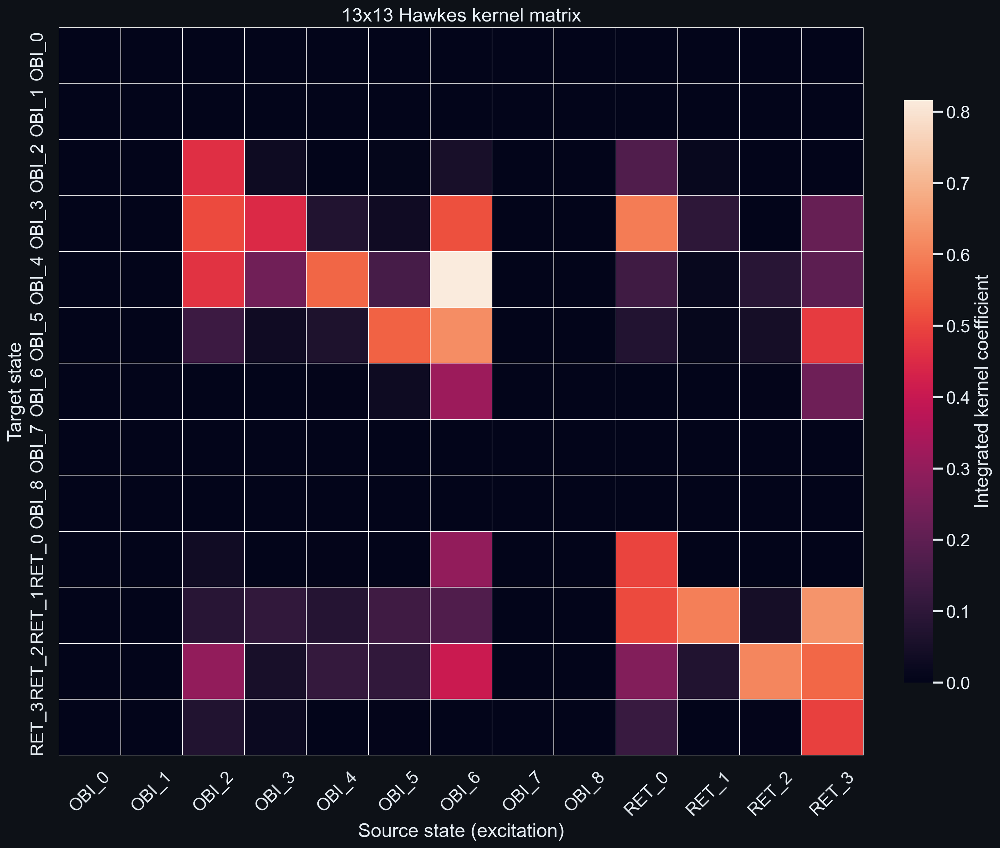

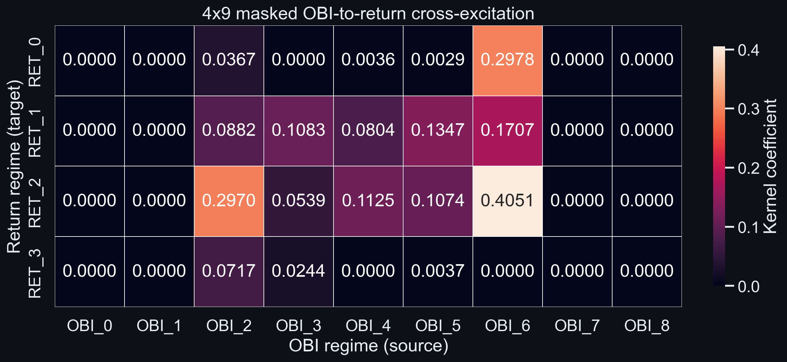

### Deterministic backtest (PnL)

Signal: volume OBI, scheme UF, horizon 1s. Execution: taker, 2.00 bps per side,
100 us latency, threshold 0.

| Metric | Value |
| --- | --- |
| Trades | 119 |
| Total return | -4.3535% |
| Mean trade return | -3.738 bps |
| Median trade return | -2.998 bps |
| Std trade return | 5.013 bps |
| Win rate | 27.73% |
| Profit factor | 0.132 |
| Sharpe (per trade) | -0.746 |
| Max drawdown | 4.3535% |
| Total fees | 476.000 bps |
| Average holding | 1000 ms |

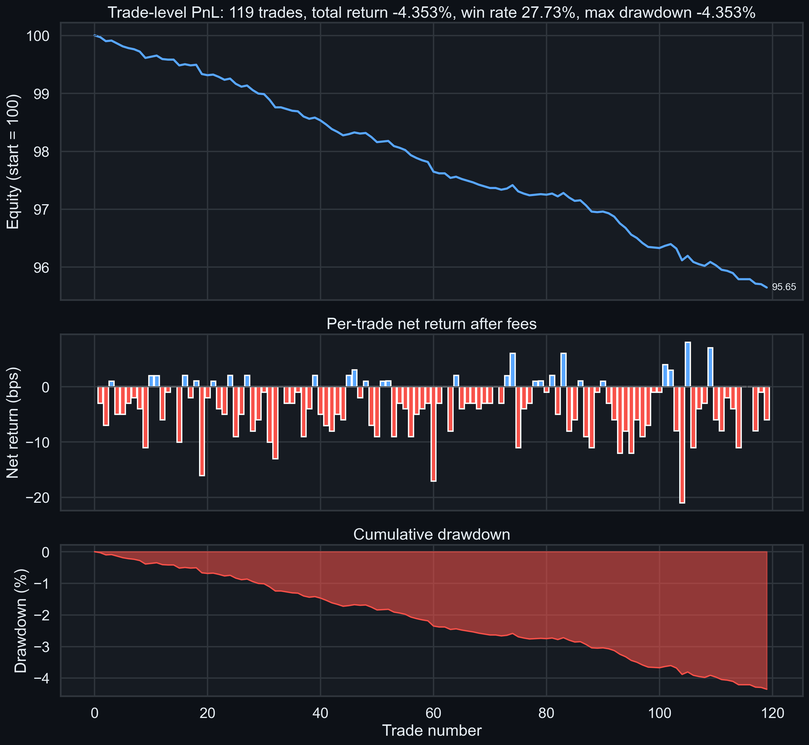

The top panel is the compounded equity curve, the middle panel shows each
trade's net return after fees, and the bottom panel is the running drawdown
for the 119-trade run. The simulator fills at the first snapshot on or after
signal time plus the configured latency, holds for the selected horizon,
applies fees to both legs, and uses non-overlapping mid-price fills.

### Real BTCUSDT L2 data

Real-data replay is intentionally reported as a negative result: public BTC
depth does **not** yet show usable alpha with this event-flow OBI
implementation.

| Metric | Real BTCUSDT L2 |
| --- | --- |
| Best count OBI | MF, 50s: Pearson -0.02995, R2 0.00090 |
| Best volume OBI | MF, 50s: Pearson 0.05404, R2 0.00292 |
| Hawkes branching ratio | 0.9900 |
| 4x9 cross-excitation norm | 0.0345 |
| PnL | not demonstrated |

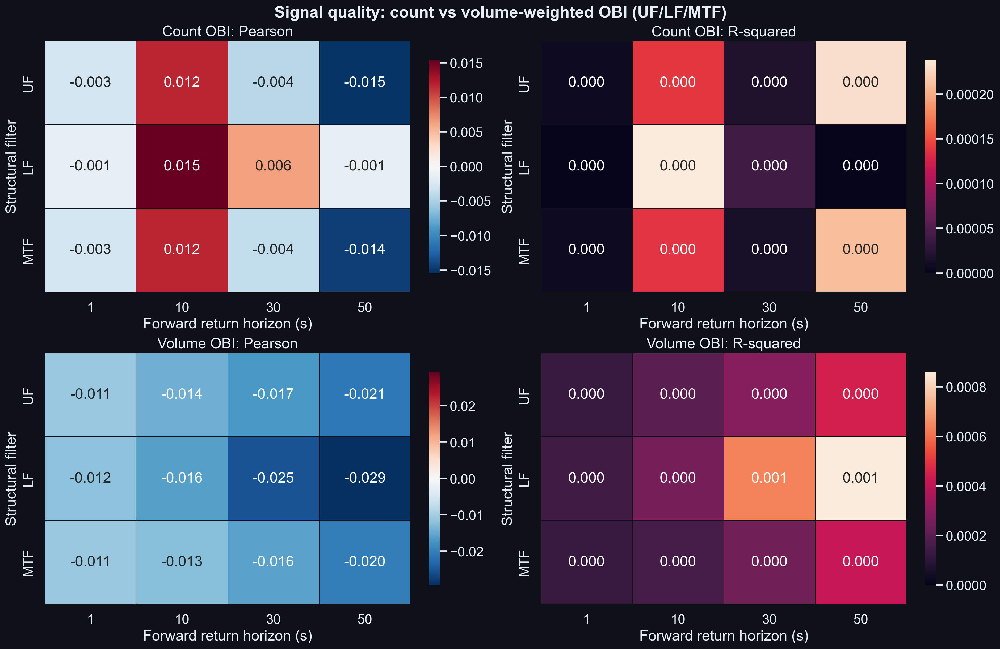

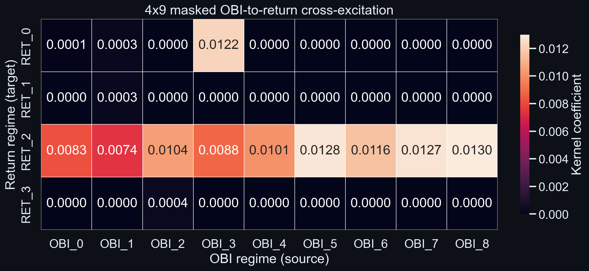

### Benchmark environment

| Field | Value |
| --- | --- |
| Host | MacBook-Air, Apple silicon, 10 logical CPUs |
| Google Benchmark | v1.9.1 |
| Build | Release, `-march=native` (pipeline default) |
| Benchmark timestamp | 2026-10-24 |

Latency and throughput are host- and compiler-dependent. Re-run the pipeline on
the target hardware before making capacity decisions.

## Paper-faithful diagnostics

The original pipeline is a causal streaming approximation. `hft_paper_eval`
adds a separate paper-faithful path:

- **Ex-post order filters.** Lifetime is final exit minus first arrival,
  modification count is the final count, and modification time is the final
  last-two-modification interval. A full fill is treated as an exit and
  tracked from the `parent_order_id` linkage; the filter mask is applied to
  every event of the order, not just the events after the threshold is reached.
- **Paper observation design.** 10 s OBI window, realized first-to-last trade
  return, 15 s anchors, and the paper's 1/10/20/30/50/80/100 s horizons.
- **Regime layer.** 9 OBI regimes and 3 return regimes (negative, neutral,
  positive), with the directional weight matrix
  `W_ij = 1 + b_i a_j` (`gamma = 0.2`), OLS regime R2, ARMA residualization
  and a positive-lag grid.
- **Hawkes layer.** A continuous-time sum-of-exponentials maximum-likelihood
  fit with a fixed decay grid, a 12-state (9 OBI + 3 return) integrated kernel,
  aligned-pair cross-excitation norm, and raw spectral radius. A discrete-time
  Poisson-basis estimator remains available for comparison. The paper's
  inconsistent 13x13/9x3 wording is documented in the report.

Run `./tools/run_paper_pipeline.sh`. For proprietary feeds with parent links,
add `hft_paper_eval --parent-map trade_id,parent_order_id`. Full results:
[`benchmarks/results/paper/PAPER_REPORT.md`](benchmarks/results/paper/PAPER_REPORT.md).

### What the paper-faithful run shows

1800 s synthetic stream, seed 11, 119 anchors:

| Layer | Result |
| --- | --- |
| Pearson at 1 s | UF 0.2416, LF 0.2393, MF 0.2362, MTF 0.2225 |
| Regime `S_rho` at 1 s | MF 0.2170, MTF 0.2080, UF 0.1297, LF 0.1183 |
| LOB Hawkes aligned norm | MF 0.0723, MTF 0.0722, UF 0.0719, LF 0.0422 |
| Trade Hawkes aligned norm | MTF 0.0622, MF 0.0617, UF 0.0502, LF 0.0501 |
| LOB spectral radius | UF 0.1490, LF 0.1488, MF 0.1212, MTF 0.1169 |

The paper's headline trade-filtered `OBI(T)` result is only **partially
reproduced**: MF/MTF raise the CT-MLE trade cross-excitation norm from 0.0502
(UF) to 0.0617/0.0622, while LF is flat at 0.0501. The effect is much smaller
than the paper's, and the public Binance/crypto-lob feeds do not provide parent
order IDs for trades. This is reported as a measured result rather than tuned
away.

Formal inference is included: bootstrap confidence intervals are reported for
the regime scores, and a chronological train/test split is reported for Pearson
association. On the 1 s horizon the train correlation is 0.30-0.32 but the test
correlation falls to 0.08-0.12, so the in-sample association does not persist
out of sample. The split-half Hawkes check shows held-out aligned norms falling
by 0.005-0.032 across schemes, with LOB signals less stable than trade signals.

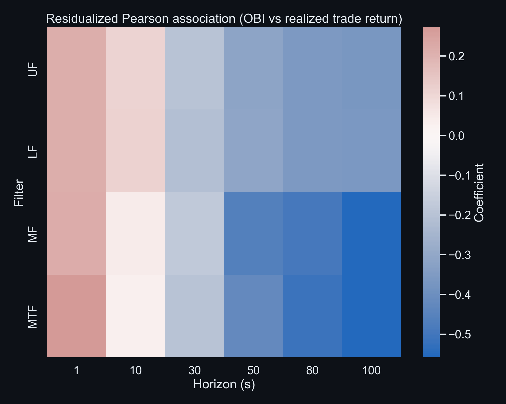

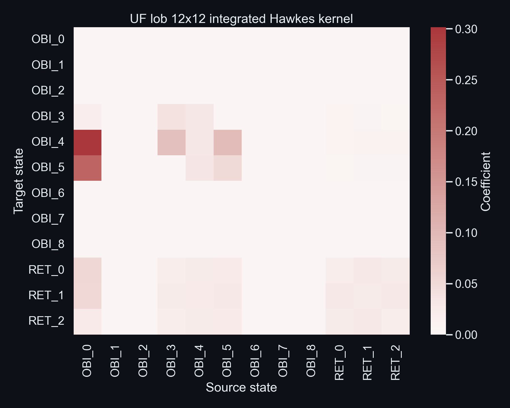

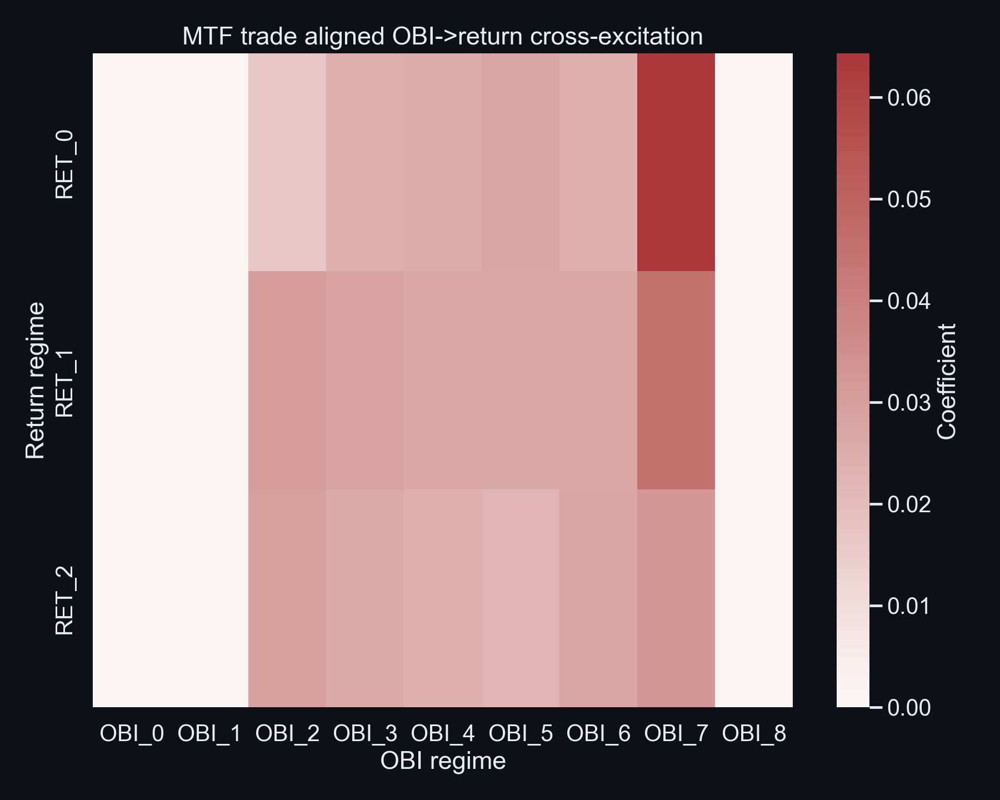

## Stress & edge cases

`./tools/run_stress.sh` builds the evaluator and exercises empty inputs,
single events, duplicate IDs, out-of-order timestamps, missing trades, a
one-day timestamp gap, `uint64`-maximum order IDs, and 60/300/900 s streams.

| Case | Wall time | Peak RSS | Output |
| --- | --- | --- | --- |
| 60 s stream, paper filters | 0.128 s | 61 MB | 960 rows, 12 anchors |
| 300 s stream, paper filters | 0.604 s | 288 MB | 4,800 rows, 76 anchors |
| 900 s stream, paper filters | 2.237 s | 856 MB | 14,400 rows, 236 anchors |
| 900 s stream, streaming filters | 1.834 s | 852 MB | 14,400 rows, 236 anchors |
| Edge cases | < 0.01 s each | < 1 MB | empty fails cleanly; all other edge cases pass |

The harness recorded **17 cases and 0 unexpected failures**. Full report:
[`benchmarks/results/stress/STRESS_REPORT.md`](benchmarks/results/stress/STRESS_REPORT.md);
machine-readable tables are in `stress_report.json` and `stress_summary.csv`.

## Low-latency transport & microbenchmarks

`./tools/run_lowlatency_bench.sh` runs a real producer/consumer hand-off
(one thread each) and the paper-2 microbenchmark suite. It also calls
`./tools/run_cache_counters.sh`, which captures Linux `perf` counters and
skips cleanly on macOS.

| Path | Median ns/event | p99 ns/event | Events/s |
| --- | --- | --- | --- |
| `std::queue` + mutex + condition variable | 88.704 | 138.236 | 10,319,034 |
| Disruptor-style ring + busy spin | 75.227 | 92.563 | 13,635,948 |

Ring speedup: **1.18x** on this noisy laptop run (15 measured runs after one
warm-up). The queue baseline wakes on a condition variable; the ring spins on
per-slot publication flags. Timing includes thread creation and join, so this
is conservative. The multi-consumer `ConsumerGroup`, group-gated producer, and
`DependencyBarrier` for staged consumers are tested in the unit suite; hardware
`perf` counters are captured by `tools/run_cache_counters.sh` on Linux and
skipped on macOS.

| Paper-2 technique | Measured effect on this host |
| --- | --- |
| `constexpr` factorial | **91.4% faster** than runtime |
| float-only arithmetic | **44.9% faster** than mixed float/double |
| `always_inline` | **57.2% faster** than `noinline` |
| loop unrolling | 44.9% slower than the plain loop |
| prefetching | 418% slower on this Apple-silicon build |
| SIMD array addition | 40.1% slower than the auto-vectorised scalar loop |
| SIMD pairs rolling window | **62.5% faster** than the scalar window |

Negative results are retained: modern compilers auto-vectorise the scalar
baselines, and prefetch/SIMD effects are host-specific. Full report:
[`benchmarks/results/lowlatency/LOW_LATENCY_REPORT.md`](benchmarks/results/lowlatency/LOW_LATENCY_REPORT.md).

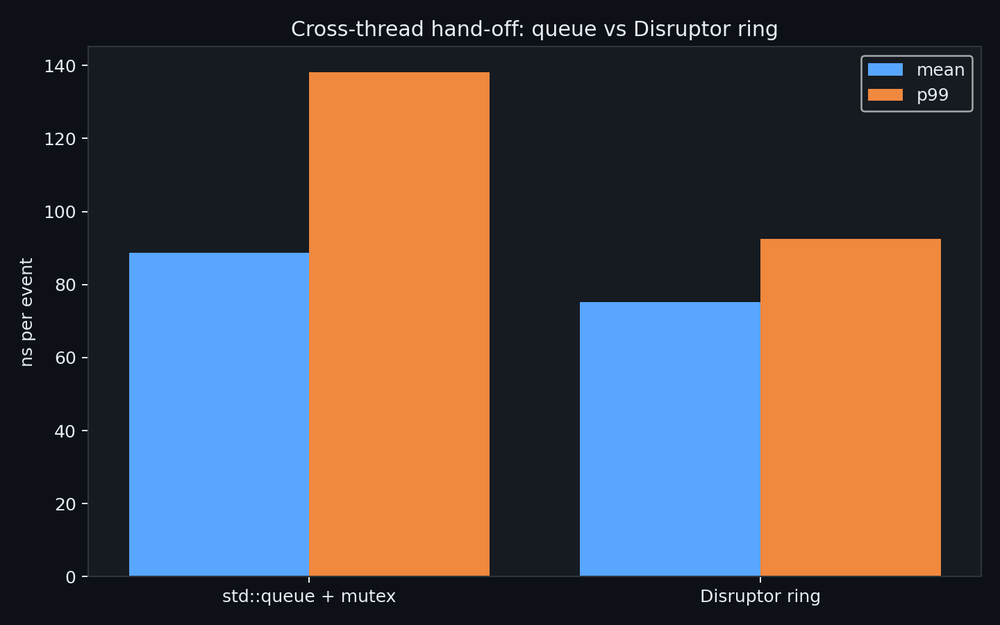

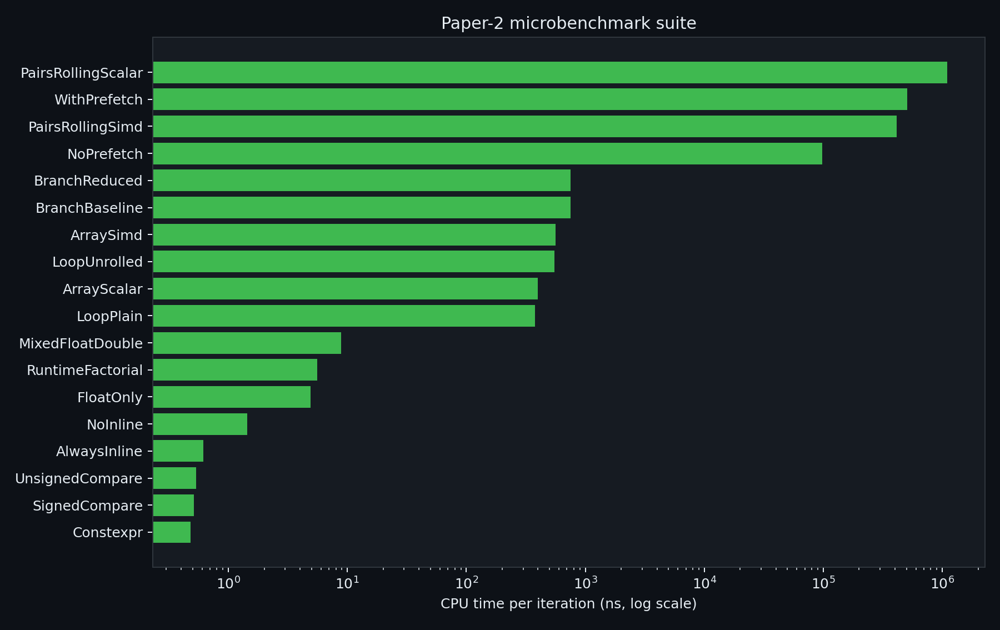

## Pairs-trading strategy (paper 2)

`benchmarks/pairs_trading.py` implements the cointegration/OLS hedge-ratio,
rolling z-score, entry/exit, and transaction-cost backtest from paper 2.
It runs on a synthetic cointegrated pair by default, or on a CSV with two
price columns.

| Metric | Result |
| --- | --- |
| ADF p-value | 1.65e-26 |
| Estimated hedge ratio | 2.0021 |
| Trades | 116 |
| Total PnL | 259.22 |
| Max drawdown | -5.69 |
| Sharpe (annualized) | 1.986 |
| Win rate | 99.14% |

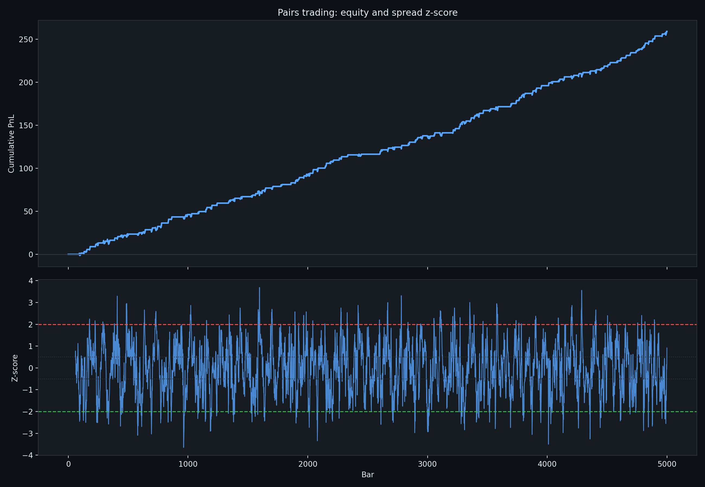

```bash
./tools/run_pairs.sh
# or: python3 benchmarks/pairs_trading.py
```

Full report: [`benchmarks/results/pairs/PAIRS_REPORT.md`](benchmarks/results/pairs/PAIRS_REPORT.md).
The paper's latency optimisation is covered by the SIMD rolling-window
microbenchmark above; the backtest itself is a strategy-math validation, not a
production execution model.

## Repository Layout

```text
include/hft/        C++ headers: queue, filters, scoring, pipeline, SDK, backtest
include/hft/Paper.hpp  paper-faithful filters and observation evaluator
src/                benchmark, evaluator, paper evaluator, threaded bench, SDK
src/microbench.cpp  paper-2 microbenchmark suite
tests/              unit, concurrency, volume, backtest, and paper tests
tools/              data ingest, pipeline, paper, stress, soak, fuzz, low-latency, cache runners
docs/               quickstart, deployment, adapters, API stability, benchmarks
config/             production hft_feed configuration
Dockerfile          multi-stage runtime image
benchmarks/         plotting, paper analysis, pairs backtest, low-latency report, results, charts
python/hft_sdk/     pip-installable package (high-level helpers + CLI)
python/bindings.cpp pybind11 bindings
pyproject.toml      scikit-build-core packaging (`pip install .`)
cmake/              package config template
.github/workflows/  CI benchmark pipeline
```

## CI

`.github/workflows/benchmark.yml` runs on pushes to `main`:

- Ubuntu runner, Clang, CMake
- Builds the engine, tests, SDK, and Python module
- Runs the benchmark/reporting pipeline, including the paper-faithful diagnostics
- Runs Python live-parser tests
- Verifies `find_package(HftSdk)` from an external consumer
- Uploads benchmark artifacts; stress/low-latency/soak reports are generated by their dedicated scripts
- Separate sanitizer workflow runs ASan/UBSan, TSan, and libFuzzer

## Limitations

- **Research prototype:** the API, signal definitions, adapters, and results are not yet production-stable.
- The current OBI implementation summarizes event flow; it is not a full resting-depth reconstruction.
- Real-data alpha is not demonstrated yet. The crypto depth slice produces near-zero R2.
- The **streaming** filter mode is causal: lifetime and modification tests use the state observed so far, not the order's final lifecycle. The **paper-faithful** mode is a separate ex-post path.
- The paper-faithful Hawkes layer uses a continuous-time sum-of-exponentials maximum-likelihood fit with a **fixed decay grid** (profile likelihood over amplitudes), not a joint free optimisation of every decay rate. It uses 9 + 3 = 12 states because the paper's text says three return regimes while referring to a 13x13 kernel.
- Parent-order IDs for trades are absent from the public Binance and crypto-lob feeds. The evaluator now supports a `--parent-map trade_id,parent_order_id` sidecar and a `parent_order_id` tick column, but public feeds still cannot reproduce the filtered `OBI(T)` result.
- The cross-thread benchmark includes thread creation/join and is not pinned-core; the microbenchmarks are compiler- and host-dependent, and negative results are retained. Hardware cache counters require Linux `perf`; the script skips cleanly on macOS.
- The Disruptor supports multi-producer, multi-consumer fan-out, group gating, and a `DependencyBarrier` for staged consumers. It does not expose a full LMAX-style event-processor graph abstraction.
- The PnL simulator uses mid-price fills and parameterized fees; it is not a production execution model.
- The pairs-trading backtest is a strategy-math validation on synthetic or user-supplied prices, not a demonstration of live alpha.
- Live adapters use public exchange endpoints and are not certified for unattended production trading; add exchange-specific rate-limit, maintenance, and recovery handling before deployment. Public market-data redistribution remains subject to exchange terms.

## References

1. **Order-Flow Filtration and Directional Association with Short-Horizon Returns** — Anantha, Jain & Maiti (2025), arXiv:2507.22712v2.
   [https://arxiv.org/abs/2507.22712](https://arxiv.org/abs/2507.22712)

   - Studies whether structural order-flow filters sharpen the association between OBI and short-horizon returns in BANKNIFTY futures.
   - **Lifetime filter (`F_T`):** rejects orders whose final dwell time in the book is below a threshold.
   - **Modification-count filter (`F_M`):** excludes orders whose final modification count exceeds a threshold.
   - **Modification-time filter (`F_MTF`):** keeps orders whose final last-two-modification interval meets a minimum.
   - The paper's diagnostic ladder is: contemporaneous Pearson association, 9x3 discretized regime scores, and Hawkes event-time excitation norms.
   - The paper reports modest and heterogeneous effects for book-based OBI, while trade-based `OBI(T)` linked to parent orders shows stronger Hawkes excitation under filtering. In v2 Table 3, the 23 January MTF example rises from 11.59 (UF) to 24.74.
   - This repository provides both a causal streaming approximation and a paper-faithful ex-post mode. The paper-faithful report explicitly documents remaining differences and negative results.

2. **C++ Design Patterns for Low-latency Applications Including High-frequency Trading** — Bilokon & Gunduz (2023), arXiv:2309.04259v1.
   [https://arxiv.org/abs/2309.04259](https://arxiv.org/abs/2309.04259)

   - Practical optimization techniques for latency-critical C++ order-management and HFT systems.
   - Reported benchmark improvements include cache warming ~90%, `constexpr` ~90.88%, loop unrolling ~72%, lock-free programming ~63%, and SIMD/AVX2 ~49%.
   - **LMAX Disruptor pattern:** preallocated ring buffer, sequence numbers, producer/consumer barriers, and no mutex on the hot path.
   - The paper's C++ Disruptor was roughly 38-55% faster than a `std::queue` guarded by a condition variable, depending on event volume.
   - Pairs-trading optimization: fixed-width buffers, AVX2 SIMD, and inlining reduced latency by 87.33%, from 517.559 ns to 65.580 ns.
   - This repository applies the systems themes: cache-friendly ring buffers, cache warming, constexpr configuration, SIMD statistics, a cross-thread Disruptor/queue benchmark, and a paper-2 microbenchmark suite. The pairs-trading/cointegration strategy is not part of this repository.

## License

Proprietary. All rights reserved. See [`LICENSE`](LICENSE) and
[`COMMERCIAL_TERMS.md`](COMMERCIAL_TERMS.md). Contact the repository owner for
commercial licensing terms. Exchange and third-party data remain subject to
their own licenses.
